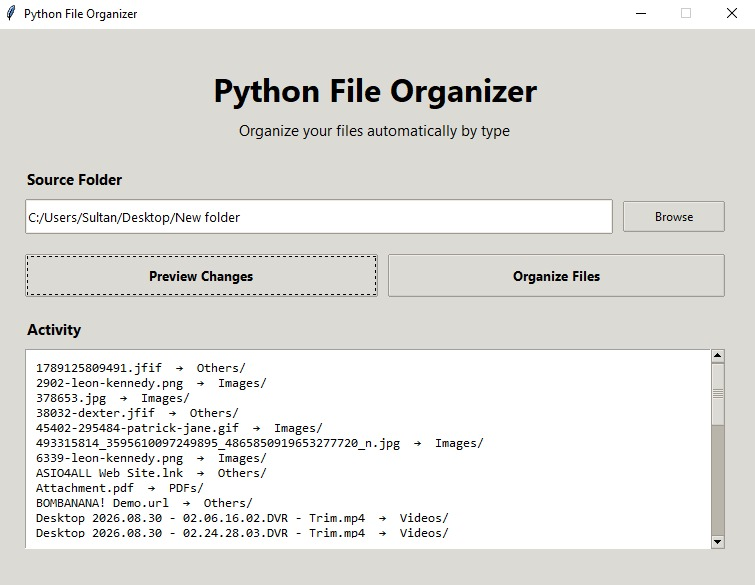
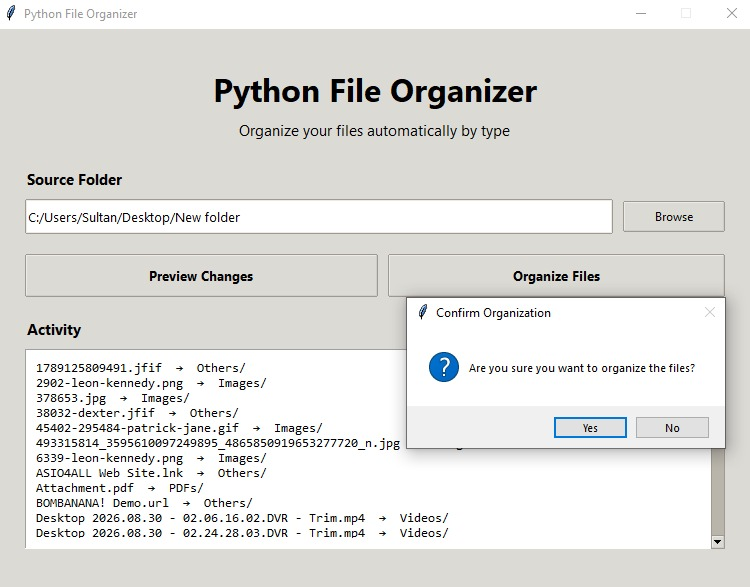
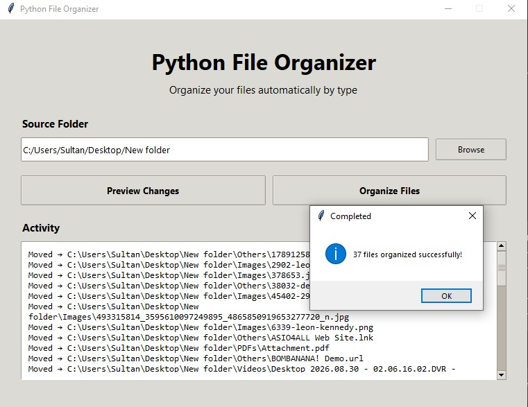

# Python File Automation Tool

A Python-based file organization tool that automatically sorts files into categorized folders based on their file extensions.

The project includes both a **Command-Line Interface (CLI)** and a **Graphical User Interface (GUI)**, with support for previewing changes and safely handling duplicate filenames.

## GUI Preview







## Features

* Automatically organizes files by type
* Supports CLI and GUI usage
* Preview changes before moving files
* Handles duplicate filenames safely
* Automatically creates destination folders
* Supports custom source folders
* Standalone Windows executable available through PyInstaller

## Supported File Categories

| Category     | Extensions                                       |
| ------------ | ------------------------------------------------ |
| Images       | `.jpg`, `.jpeg`, `.png`, `.gif`, `.webp`, `.svg` |
| Videos       | `.mp4`, `.mkv`, `.avi`, `.mov`, `.wmv`           |
| Audio        | `.mp3`, `.wav`, `.flac`, `.aac`, `.ogg`          |
| PDFs         | `.pdf`                                           |
| Documents    | `.doc`, `.docx`, `.txt`, `.rtf`                  |
| Spreadsheets | `.xls`, `.xlsx`, `.csv`                          |
| Archives     | `.zip`, `.rar`, `.7z`, `.tar`, `.gz`             |
| Others       | Unsupported file extensions                      |

## Project Structure

```text
python-file-automation/
├── src/
│   ├── organizer.py
│   ├── main.py
│   └── gui.py
├── screenshots/
│   ├── gui_1.jpeg
│   ├── gui_2.jpeg
│   └── gui_3.jpeg
├── logs/
├── requirements.txt
├── README.md
└── .gitignore
```

## How It Works

The tool scans the selected folder, identifies files based on their extensions, and moves them into the appropriate category folder.

```text
Source Folder
      │
      ▼
Scan Files
      │
      ▼
Detect File Type
      │
      ▼
Assign Category
      │
      ▼
Create Destination Folder
      │
      ▼
Handle Duplicate Names
      │
      ▼
Move File
```

## CLI Usage

### Installation

Clone the repository and install the required dependencies:

```bash
pip install -r requirements.txt
```

### Organize a Folder

```bash
python src/main.py --source "D:\Downloads"
```

### Preview Changes

Use `--dry-run` to preview the organization without moving any files:

```bash
python src/main.py --source "D:\Downloads" --dry-run
```

Example:

```text
[DRY RUN] report.pdf -> PDFs/
[DRY RUN] photo.jpg -> Images/
[DRY RUN] music.mp3 -> Audio/
[DRY RUN] archive.zip -> Archives/
```

## GUI Usage

Run the graphical interface with:

```bash
python src/gui.py
```

The GUI allows you to:

1. Select a source folder
2. Preview the changes
3. Organize the files
4. View the activity and results

## Duplicate File Handling

If a file with the same name already exists in the destination folder, the tool automatically generates a unique filename instead of overwriting the existing file.

Example:

```text
report.pdf
report_1.pdf
report_2.pdf
```

This helps prevent accidental data loss.

## Windows Executable

A standalone Windows executable can be created using PyInstaller:

```bash
pip install pyinstaller
```

Then:

```bash
pyinstaller --onefile --windowed --name "PythonFileOrganizer" src/gui.py
```

The executable will be generated inside:

```text
dist/PythonFileOrganizer.exe
```

## Technologies

* Python
* Tkinter
* pathlib
* shutil
* argparse
* PyInstaller

## Use Cases

This tool can be useful for:

* Organizing Downloads folders
* Cleaning up large collections of files
* Automating repetitive file-management tasks
* Sorting files into predefined categories
* Creating simple desktop automation tools

## Purpose

This project demonstrates practical Python automation concepts including:

* File and directory handling
* Path management
* File categorization
* Automation with `shutil`
* Command-line interfaces
* GUI development with Tkinter
* Error handling
* Duplicate file management
* Windows executable packaging

## License

This project is available for educational and portfolio purposes.
